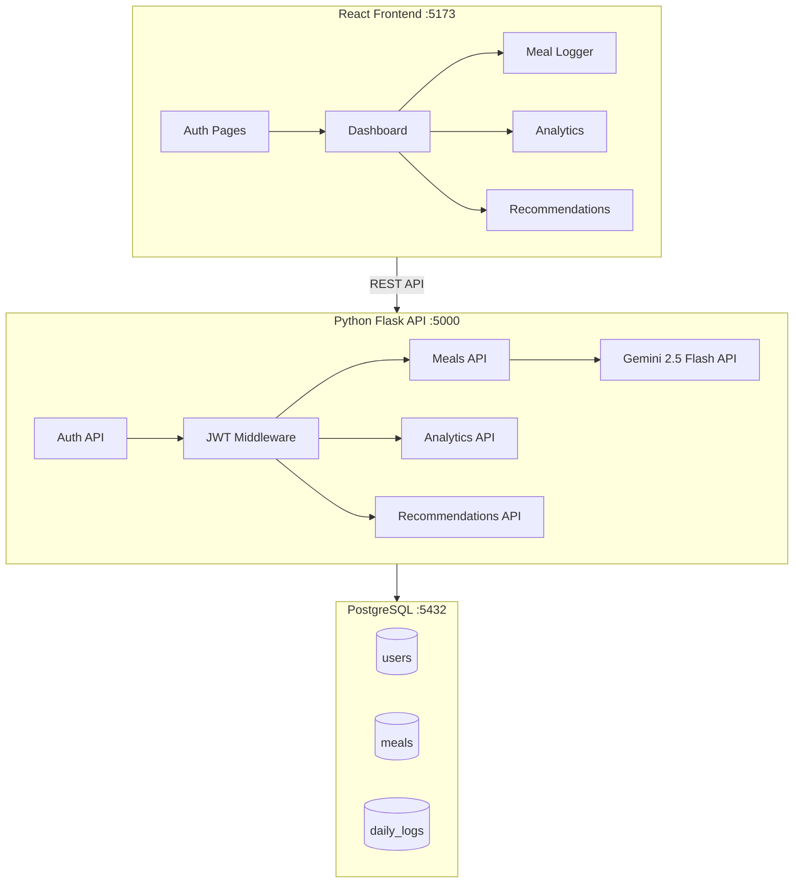

# StayFit - AI Calorie Tracker Implementation Plan

## Overview
A full-stack calorie tracking application where users photograph meals, and AI (Gemini 2.5 Flash) identifies food items and estimates calories.

## Architecture



## Tech Stack
| Layer | Technology |
|-------|-----------|
| Frontend | React 18 + Vite, Chart.js, React Router |
| Backend | Python Flask, Flask-JWT-Extended, SQLAlchemy |
| Database | PostgreSQL |
| AI | Google Gemini 2.5 Flash API |

## Database Schema

### users
- id (UUID, PK)
- email (VARCHAR, UNIQUE)
- password_hash (VARCHAR)
- name (VARCHAR)
- age (INT)
- gender (VARCHAR)
- weight_kg (FLOAT)
- height_cm (FLOAT)
- activity_level (VARCHAR)
- goal (VARCHAR) - lose/maintain/gain
- daily_calorie_budget (INT)
- created_at (TIMESTAMP)

### meals
- id (UUID, PK)
- user_id (UUID, FK → users)
- meal_type (VARCHAR) - breakfast/lunch/dinner/snack
- image_url (VARCHAR)
- food_items (JSONB)
- total_calories (INT)
- protein_g (FLOAT)
- carbs_g (FLOAT)
- fat_g (FLOAT)
- logged_at (TIMESTAMP)

### daily_logs
- id (UUID, PK)
- user_id (UUID, FK → users)
- date (DATE)
- total_calories (INT)
- budget (INT)
- created_at (TIMESTAMP)

## Features to Build
1. ✅ User Registration & Login (JWT)
2. ✅ Profile Setup with calorie budget calculation
3. ✅ Meal photo upload → Gemini AI analysis
4. ✅ Daily calorie tracking dashboard
5. ✅ AI meal recommendations
6. ✅ Weekly analytics with charts
7. ✅ Smart notifications (approaching/exceeding limits)

## Project Structure
```
project3/
├── backend/
│   ├── app/
│   │   ├── __init__.py
│   │   ├── config.py
│   │   ├── models.py
│   │   ├── routes/
│   │   │   ├── auth.py
│   │   │   ├── meals.py
│   │   │   ├── analytics.py
│   │   │   └── recommendations.py
│   │   └── services/
│   │       ├── gemini_service.py
│   │       └── calorie_service.py
│   ├── requirements.txt
│   ├── run.py
│   └── .env.example
├── frontend/
│   ├── src/
│   │   ├── components/
│   │   ├── pages/
│   │   ├── context/
│   │   ├── services/
│   │   └── App.jsx
│   └── package.json
└── database/
    ├── init.sql
    └── README.md
```
